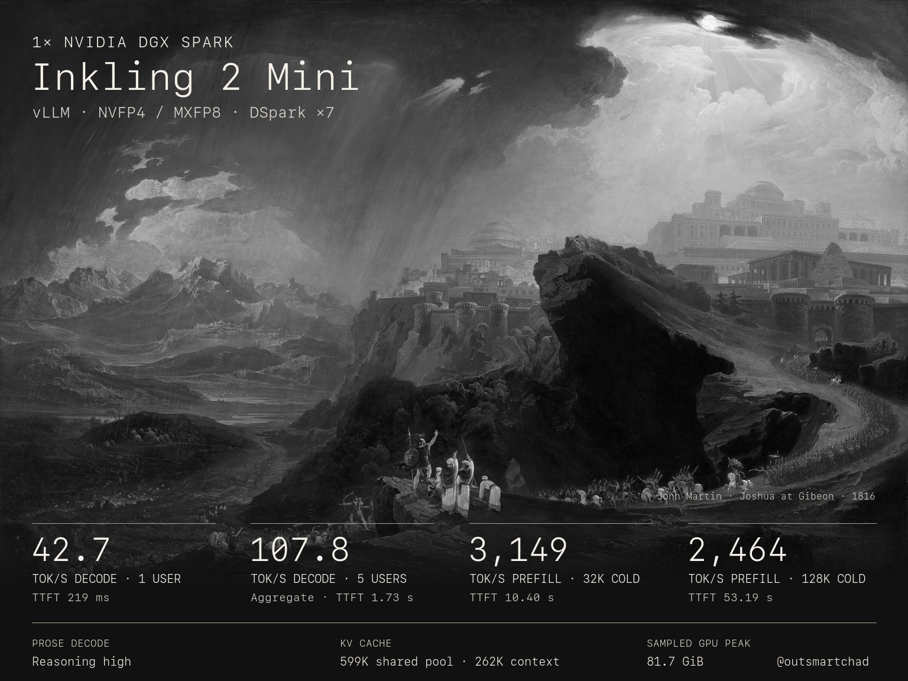

# Inkling 2 Mini on one DGX Spark with vLLM

Reproduce the November 21, 2026 single-Spark baseline using the official **26.4B** checkpoint, mixed **NVFP4/MXFP8** weights, and native **DSpark ×7**. The API listens at `127.0.0.1:18905`. [Model card](https://huggingface.co/thinkingmachines/Inkling-2-Mini) · [vLLM launch notes](https://vllm.ai/blog/2026-11-20-inkling2-mini)



## Baseline performance

| Workload | Throughput | TTFT |
|---|---:|---:|
| Prose decode, 1 stream | 42.7 tok/s | 219 ms |
| Prose decode, 5 streams | 107.8 tok/s aggregate | 1.73 s |
| 32K cold prefill | 3,149 tok/s | 10.40 s |
| 128K cold prefill | 2,464 tok/s | 53.19 s |

Decode uses high reasoning effort with 400 output tokens per request. Prefill uses three fresh prompts per size, with zero cached input tokens. The synthetic audit code matched exactly in five of six measured requests. One 32K request reached its 512-token output budget before delivering an answer. The model's sampled GPU memory peak was **81.7 GiB**.

[All 1–5 stream results, test settings, and raw data](docs/baseline.md)

[Controlled tuning results](docs/optimization.md) cover greedy drafting, classic CUDA graphs, and DSpark off.

## Run on the Spark

Requirements are a DGX Spark and Docker with NVIDIA GPU support. Git, Python 3, and curl are used by the recipe and benchmark client. Allow disk space for the **18.8 GiB** pinned checkpoint, ARM64 image, and persistent CUDA caches. Pause other inference workloads before launching this measured configuration.

```bash
git clone https://github.com/outsmartchad/inkling-2-mini-single-dgx-spark-vllm.git
cd inkling-2-mini-single-dgx-spark-vllm
./bin/recipe.sh fetch
./bin/recipe.sh serve
```

The download step uses a pinned image digest and checkpoint revision. The serving step mounts the weights read-only, uses an offline Hub configuration, and binds the API to loopback. Use an absolute `INKLING_CACHE` directory to share the staged files across checkouts.

In a second shell on the Spark, from this checkout:

```bash
curl --noproxy '*' -fsS http://127.0.0.1:18905/v1/models
./bin/recipe.sh benchmark
```

The benchmark writes raw results under `runs/`. When finished, press Ctrl-C in the serving terminal to stop Inkling. Restart your prior inference service if you paused it for the run.

## Configuration

- Official checkpoint `thinkingmachines/Inkling-2-Mini` at `ed40e7da`.
- ARM64 vLLM release `0.1.dev25855+g7cb5dae22.cu130`, pinned by image digest in the launcher.
- One GPU, native DSpark ×7 with probabilistic drafts, automatic KV dtype, 262,144-token request context, and up to five concurrent requests.
- The runtime reported a shared KV capacity of 599,083 tokens. The five-stream benchmark used short prompts.
- Prefix cache disabled for these measurements. Cold-prefill scores are actual prompt tokens divided by client TTFT.

MIT for the recipe scripts and documentation. The [upstream model card](https://huggingface.co/thinkingmachines/Inkling-2-Mini) describes the checkpoint and its license.
